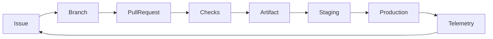

# AZ-400 Complete Course: Designing and Implementing Microsoft DevOps Solutions

This course turns the skills outline dated July 27, 2026 in `readme.md` into a practical learning path. It covers every listed skill area, with lesson notes, labs, commands, and exercises. Commands use Bash unless stated otherwise. Replace values in angle brackets before running commands.

For the course split into separate files by module, start at the [AZ-400 Modular Course index](modules/README.md). Each module separates lesson notes, lab notes, exercises, and verification.

> **Cost and safety:** Labs that create Azure resources can incur charges. Use a dedicated subscription and resource group, set budgets, avoid production credentials/data, and delete lab resources when finished. Never commit secrets. Some features require paid GitHub, Azure DevOps, Defender for Cloud, or Azure plans. Check current product availability and licensing before a lab; service names and interfaces evolve.

## Course Map

| Module | Area | Exam weight |
|---|---|---:|
| 0. Lab setup and delivery lifecycle | Foundations | — |
| 1. Work, flow, traceability, and metrics | Processes and communications | Part of 10–15% |
| 2. Documentation, collaboration, and integrations | Processes and communications | Part of 10–15% |
| 3. Git strategy, pull requests, and repository governance | Source control | Part of 10–15% |
| 4. Repository scale, large files, and Git recovery | Source control | Part of 10–15% |
| 5. Packages, feeds, and versioning | Build and release pipelines | Part of 50–55% |
| 6. Test strategy, quality gates, and coverage | Build and release pipelines | Part of 50–55% |
| 7. Pipeline design, YAML, agents, and reuse | Build and release pipelines | Part of 50–55% |
| 8. Deployment strategies and application releases | Build and release pipelines | Part of 50–55% |
| 9. Infrastructure as code and environment configuration | Build and release pipelines | Part of 50–55% |
| 10. Pipeline operations, optimization, and migration | Build and release pipelines | Part of 50–55% |
| 11. Identity, authentication, permissions, and teams | Security and compliance | Part of 10–15% |
| 12. Secrets, keys, certificates, and secure files | Security and compliance | Part of 10–15% |
| 13. Security scanning, supply chain, and compliance | Security and compliance | Part of 10–15% |
| 14. Monitoring and telemetry collection | Instrumentation | Part of 5–10% |
| 15. Metrics, traces, logs, and operational feedback | Instrumentation | Part of 5–10% |
| 16. End-to-end capstone and exam review | All areas | — |

Suggested pace: one module per study session, then repeat the lab without notes. Spend proportionally more time on Modules 5–10 because pipelines account for 50–55% of the exam.

## Learning Outcomes

By the end, you should be able to design and operate a traceable DevOps lifecycle across GitHub and Azure DevOps; implement secure, tested, reusable CI/CD; choose deployment and infrastructure strategies; secure identities and software supply chains; and instrument services so teams can act on operational feedback.

For step-by-step lab procedures, verification criteria, exercises, and cleanup, use the companion [AZ-400 Lab Workbook](AZ-400-lab-workbook.md).

## 0. Lab Setup and Delivery Lifecycle

### Lesson notes

AZ-400 expects both development and Azure administration experience, plus familiarity with GitHub and Azure DevOps. A useful reference lifecycle is:

1. Capture work in GitHub Issues/Projects or Azure Boards.
2. Branch, commit, and open a pull request (PR); link changes to work items.
3. Run build, test, security, and policy checks.
4. Publish versioned packages and pipeline artifacts.
5. Deploy through controlled environments, with approvals and progressive exposure.
6. Monitor health, collect feedback, and create follow-up work.

### Tools and accounts

- Git; GitHub account and repository; GitHub CLI (`gh`).
- Azure subscription; Azure CLI (`az`); Microsoft Entra tenant.
- Azure DevOps organization/project and Azure DevOps CLI extension if using CLI labs.
- Optional depending on labs: Docker, .NET SDK, Node.js/npm, Python/pytest, `kubectl`, Bicep CLI, Terraform, Git LFS, Scalar, and a code editor.
- Services used in the objectives: GitHub Actions, GitHub Packages, GitHub Advanced Security, Azure Boards, Azure Repos, Azure Pipelines, Azure Artifacts, Azure Key Vault, Azure App Configuration Feature Manager, Azure Monitor, Application Insights, VM/Container/Storage/Network Insights, Microsoft Defender for Cloud DevOps Security, Azure Deployment Environments, Azure Automation State Configuration, Azure Resource Manager, Bicep, and Azure Machine Configuration.

### Verify tools and identity

```bash
git --version
gh --version
az version
gh auth status
az account show --output table
az account list --output table
```

Authenticate interactively when needed:

```bash
gh auth login
az login
az account set --subscription <subscription-id>
```

Do not paste access tokens into command history. Use the provider's supported sign-in flow, managed identity, or workload identity federation for automation.

### Exercise

Create a course notebook/repository. Record your tenant, subscription, GitHub plan, Azure DevOps organization, enabled extensions, and any features unavailable due to licensing. Do not record secrets. Identify which labs can run locally and which create billable resources.

## 1. Work, Flow, Traceability, and Metrics

### Lesson notes

**Work flow and GitHub Flow:** Keep the main branch releasable. Create short-lived branches, make focused commits, open a PR, require checks/review, merge, then deploy. Smaller batches reduce queue time and make feedback faster. Compare this to trunk-based development (very short-lived branches and frequent integration) and release-branch development (maintenance/release stabilization branches).

**Work tracking:** GitHub Issues and Projects support issue/PR-based planning and views. Azure Boards provides work items, backlogs, queries, dashboards, and Analytics. Integrate work and source so a user story/issue can be followed through branch, commit, PR, build, deployment, bug, and release. Use consistent IDs and links; avoid relying on commit-message conventions alone.

For Azure Boards CLI work, install and configure the extension once, then use WIQL for repeatable queries:

```bash
az extension add --name azure-devops
az devops configure --defaults organization=https://dev.azure.com/<organization> project=<project>
az boards work-item create --title "Add health endpoint" --type "User Story"
az boards query --wiql "SELECT [System.Id], [System.Title], [System.State] FROM WorkItems WHERE [System.WorkItemType] = 'Bug' AND [System.State] <> 'Closed' ORDER BY [System.ChangedDate] DESC"
```

Authenticate with `az devops login` only when needed and provide the credential through a secure prompt/approved credential flow, not a command literal. Prefer the signed-in identity and scoped permissions.

**Traceability:** Define how requirements map to commits, pull requests, test results, security findings, artifacts, deployments, and incidents. Include source revision and artifact version in release metadata. Make traceability queryable and retain records according to policy.

**Metrics:** Distinguish outcome/flow measures from activity counts. Useful delivery measures include lead time for changes, deployment frequency, change failure rate, and time to restore service. Also track cycle time, work-item aging, queue time, build duration/failure rate, flaky tests, escaped defects, vulnerability remediation time, and service-level indicators. Metrics should prompt investigation, not reward gaming or compare teams without context.

### Lab: issue-to-change traceability

```bash
gh repo create <owner>/<repo> --public --clone
cd <repo>
gh issue create --title "Add health endpoint" --body "Expose service health for monitoring."
git switch -c feature/health-endpoint
# Make a small code change, then:
git add .
git commit -m "Add health endpoint"
git push -u origin feature/health-endpoint
gh pr create --title "Add health endpoint" --body "Closes #1"
```

In a private or organization repository, choose the appropriate visibility and access controls. In Azure Boards, create a work item and link it to the corresponding branch, commit, or PR using the supported Azure DevOps/GitHub integration. Verify the link from both sides.

### Exercise

For a sample service, draw the requirement-to-production traceability path. Define one metric for planning, development, testing, security, delivery, and operations. For each metric, state its source, calculation/window, owner, and action when it moves outside its target. Build a dashboard that shows cycle time, lead time, time to recovery, build health, and deployment outcomes.

## 2. Documentation, Collaboration, and Integrations

### Lesson notes

- Use repository Markdown for versioned technical and release documentation. Keep architecture and process diagrams near the code; Mermaid can express flowcharts, sequence diagrams, and state diagrams.
- A wiki is useful for collaboratively maintained project knowledge. Establish ownership, review, and link-checking practices so documentation stays current.
- Generate release notes from merged PRs, labels, milestones, or Git history. Curate the output; raw commit logs are not a user-facing changelog.
- Document APIs from their source contract (for example, OpenAPI) and publish versioned docs with the service.
- Webhooks notify external systems about events. Validate signatures, use HTTPS, minimize payload/permissions, handle retries/idempotency, and avoid putting secrets in payloads.
- Integrate Azure Boards with GitHub repositories to connect planning and code. Integrate GitHub/Azure DevOps with Microsoft Teams for notifications, while controlling channel noise and sensitive content.

### Mermaid example



### Lab: documentation and change notes

```bash
git log --oneline --decorate -10
git log --since="2 weeks ago" --pretty=format:"%h %s (%an)"
gh release create v1.0.0 --generate-notes --title "v1.0.0"
```

Create a `docs/` folder with an architecture diagram, a deployment/runbook page, and an API contract. Add a pull-request template requiring a work-item link, tests, risk, and documentation impact. Configure a test webhook receiver or use a non-production integration; confirm delivery, signature validation, retry behavior, and idempotency. Connect a test Azure Boards project and Teams channel using the provider's integration settings.

### Exercise

Propose a documentation plan covering wiki vs repository Markdown, process diagrams, release notes, API docs, and Git-history automation. Specify who owns each document and how stale documentation is detected. Design a webhook integration failure mode and recovery path.

## 3. Git Strategy, Pull Requests, and Repository Governance

### Lesson notes

Choose a branching model based on release cadence, team size, deployment capability, and support requirements:

- **Trunk-based:** integrate small changes frequently; use feature flags for incomplete work.
- **Feature branches:** isolate work briefly and merge through review and checks.
- **Release branches:** stabilize and service supported versions independently; avoid long-lived divergence.

Protect important branches with required reviews, status checks, conversation resolution, signed commits where required, linear-history or merge restrictions where appropriate, and restricted bypass rights. Azure Repos branch policies and GitHub branch protection/rulesets implement related controls. Require checks that are deterministic and maintained. Decide merge method (merge commit, squash, or rebase) and document its effect on history and release automation.

### Lab: branch and PR workflow

```bash
git clone <repository-url>
cd <repository>
git switch -c feature/<short-name>
git status --short
git add <files>
git commit -m "Describe the change"
git push -u origin feature/<short-name>
```

Use the GitHub UI or organization-approved API/CLI to configure a ruleset: target the default branch, require PRs, require at least one review, require CI/security status checks, dismiss stale approvals when new commits arrive if policy requires, and limit bypass. In Azure Repos, configure branch policies for reviewers, build validation, linked work items, and comment resolution. Check permissions using a non-admin test account.

### Exercise

Choose trunk-based, feature-branch, or release-branch strategy for (a) a SaaS product deploying daily and (b) a supported on-prem product with quarterly releases. Specify branch names/lifetimes, merge policy, protection rules, hotfix handling, and how incomplete features stay hidden.

## 4. Repository Scale, Large Files, and Git Recovery

### Lesson notes

- Keep generated binaries, build outputs, and secrets out of normal Git history. Use artifact/package storage for releases.
- Git LFS stores pointers in Git and large objects in LFS storage. Track only appropriate large source assets; account for storage/bandwidth quotas.
- `git-fat` is an alternative large-file workflow that relies on external storage and team conventions; assess maintenance, access, and availability before adopting it.
- Scalar configures Git for very large repositories (including features such as background maintenance and partial clone workflows). Cross-repository sharing/submodules/subtrees/packages each have trade-offs in versioning, access, and update coordination.
- Tags identify immutable source/release points. Protect release tags and follow a naming/versioning policy.
- Recovery tools include `git restore`, `git revert`, `git reflog`, and `git fsck`. Removing sensitive data from history is a coordinated incident response, not a normal revert; rotate exposed credentials first, then use a history-rewrite tool such as `git filter-repo`, force-update affected refs, and coordinate fresh clones.

### Lab: LFS and safe recovery

```bash
git lfs install
git lfs track "*.psd" "*.zip"
git add .gitattributes
git add <large-asset>
git commit -m "Track design asset with LFS"
git lfs ls-files
```

Try recovery in a disposable repository:

```bash
git log --oneline
git revert <commit-sha>       # Safe, history-preserving undo of a shared commit
git reflog                    # Find a prior local HEAD after an accidental reset
git switch -c recovery/<name> <reflog-or-commit-ref>
git tag -a v1.0.0 -m "Release 1.0.0"
```

For a large-repository trial, compare a normal clone with Scalar:

```bash
scalar clone <repository-url>
scalar list
```

If the supported Git distribution does not include Scalar, install it using the official distribution for the OS. To remove a file from all Git history in a disposable repository after revoking any exposed credential, install `git-filter-repo` and run:

```bash
git filter-repo --path path/to/exposed-file --invert-paths
```

This rewrites commit IDs and does not remove copies in forks, caches, or clones. Coordinate a controlled force-push and fresh clones only under the repository owner's incident procedure. For `git-fat`, first select and install a maintained implementation, then follow that implementation's documented setup/fetch/push workflow; do not assume interchangeable command syntax across implementations.

For uncommitted changes, inspect `git status` and use `git restore <path>` only when you intend to discard those changes. For a mistakenly committed secret: revoke/rotate it immediately, notify security, identify all refs/caches/forks, follow the organization's history-rewrite procedure, and verify the secret is no longer usable. History removal alone does not make a credential safe.

### Exercise

Design a repository scale plan for a monorepo with large media assets and shared libraries. Compare LFS, Scalar, separate repositories, submodules/subtrees, and package publishing. Then write a recovery runbook for a deleted branch, a bad shared commit, and an exposed credential.

## 5. Packages, Feeds, and Versioning

### Lesson notes

Package tools include GitHub Packages and Azure Artifacts. Feeds can host internal packages and proxy upstream sources. Use upstream sources deliberately, pin/lock dependencies, scan dependencies, and promote approved packages through views/stages rather than letting every pipeline consume arbitrary versions.

Choose versioning according to the artifact and consumers:

- **SemVer:** `MAJOR.MINOR.PATCH`, with pre-release/build metadata where appropriate. A breaking public API change should not be represented as a patch.
- **CalVer:** date-based versions, useful when release date/order matters more than API compatibility promises.
- **Pipeline artifacts:** include immutable build identity, source commit, and run/build number; do not overwrite a version consumers already use.

Separate package version from pipeline run number when their meanings differ. Define retention, immutability, signing/provenance, promotion, and rollback.

### Lab: publish and consume

Create a test package in one ecosystem and publish it to a private GitHub Packages or Azure Artifacts feed using an organization-approved identity. Example local .NET workflow:

```bash
dotnet pack <project.csproj> --configuration Release --output ./artifacts
dotnet nuget add source <feed-url> --name <feed-name> --username <user> --password <token> --store-password-in-clear-text
dotnet nuget push ./artifacts/<package>.nupkg --source <feed-name> --api-key az
```

The example stores credentials in local NuGet configuration and is for a disposable lab only; prefer credential providers and pipeline service connections. Do not place tokens in source control or shared logs. For npm, Python, containers, or other ecosystems, configure the corresponding registry/feed and authenticate through its supported credential provider.

### Exercise

Define a versioning and promotion policy for a library, a container image, and a deployable pipeline artifact. Include feed views (development/validated/release), upstream package policy, dependency pinning, provenance, retention, and rollback.

## 6. Test Strategy, Quality Gates, and Coverage

### Lesson notes

Build a test pyramid appropriate to the architecture:

- Local/static checks and fast unit tests on each change.
- Integration/contract tests for component boundaries and dependencies.
- End-to-end tests for critical user journeys; keep them focused to reduce flakiness.
- Load/performance and resilience tests in representative, controlled environments.

Publish test results in a standard format, retain logs/results, and make failures visible. Configure test agents with required SDKs, browsers, services, and network access. Parallelize only when tests are isolated and capacity/cost justify it. Code coverage is a diagnostic signal; set realistic thresholds and prevent teams from optimizing only for line coverage. Gates can include tests, code review, vulnerability thresholds, licensing policy, approvals, and business checks.

### Lab: pipeline tests and coverage

Representative commands (use the one matching your project):

```bash
dotnet test <solution.sln> --configuration Release --collect:"XPlat Code Coverage"
npm ci && npm test -- --ci --coverage
python -m pip install -r requirements-dev.txt
pytest --junitxml=test-results.xml --cov=src --cov-report=xml
```

In GitHub Actions or Azure Pipelines, configure the test task/step to publish JUnit/TRX results and coverage reports, fail the job on test failure, and upload diagnostic artifacts even on failure. Add a quality gate for the default branch and a separate environment approval for deployment. Include one deliberately failing test and verify that no deployment occurs.

### Exercise

For a web API, design a test matrix across local, unit, integration, contract, load, and deployment validation. Decide which tests run on every PR, nightly, or pre-release. Define handling for flaky tests, test data, parallel agents, coverage, and a quality/security gate that does not hide failures.

## 7. Pipeline Design, YAML, Agents, and Reuse

### Lesson notes

Select GitHub Actions or Azure Pipelines based on source location, integrations, governance, agent needs, skills, and existing investment. Azure Pipelines can build GitHub repositories; configure repository authorization, triggers, and status reporting explicitly.

Design pipelines as code. Define event/path/branch triggers, stages, jobs, dependencies, conditions, variables, artifacts, and environments. Use multi-stage pipelines for build/test/deploy promotion. Use parallel jobs for independent work; use sequential dependencies where order matters. YAML templates, task groups, variable templates/groups, and reusable workflows/actions reduce duplication. Pin third-party actions/tasks to trusted versions/SHAs and review updates.

Agent/runner choice depends on cost, concurrency, operating system/tool needs, network connectivity, licensing, security isolation, and maintenance. Hosted agents simplify maintenance; self-hosted runners/agents enable custom tools/private networks but are privileged infrastructure. Use ephemeral or isolated agents for untrusted PR workloads, avoid sharing sensitive state, and keep images patched.

### GitHub Actions starter

```yaml
name: ci
on:
  pull_request:
  push:
    branches: [main]
permissions:
  contents: read
jobs:
  build-test:
    runs-on: ubuntu-latest
    steps:
      - uses: actions/checkout@v4
      - name: Set up .NET
        uses: actions/setup-dotnet@v4
        with:
          dotnet-version: 8.0.x
      - run: dotnet restore
      - run: dotnet build --configuration Release --no-restore
      - run: dotnet test --configuration Release --no-build
```

Pin actions to reviewed commit SHAs for hardened production workflows. Set least-privilege `permissions`, avoid executing untrusted code in privileged `pull_request_target` workflows, and do not echo secrets.

### Azure Pipelines starter

```yaml
trigger:
  branches:
    include: [main]
pr:
  branches:
    include: [main]
pool:
  vmImage: ubuntu-latest
stages:
- stage: BuildTest
  jobs:
  - job: Build
    steps:
    - script: dotnet restore
    - script: dotnet build --configuration Release --no-restore
    - script: dotnet test --configuration Release --no-build
```

### Lab and exercises

1. Run the starter pipeline on a sample repository. Confirm PR and main-branch triggers, test reporting, and artifact creation.
2. Add path filters, a second platform job, a dependent packaging stage, and a reusable YAML template.
3. Add a protected deployment environment with approvals/checks. Verify a PR cannot deploy to production.
4. Compare hosted and self-hosted agents for a private-network build. Document connectivity, patching, tool installation, capacity, isolation, cost, and licensing.
5. Connect an Azure Pipelines pipeline to GitHub; verify service connection scope and PR status reporting.

## 8. Deployment Strategies and Application Releases

### Lesson notes

Choose deployment strategy to balance risk, capacity, speed, and rollback:

- **Blue-green:** two environments; switch traffic after validation. Fast rollback, but requires duplicate capacity and compatible data changes.
- **Canary:** route a small percentage/cohort first; expand when telemetry is healthy.
- **Ring/progressive exposure:** deploy to increasingly broad groups/regions.
- **Rolling:** update instances incrementally; maintain capacity and compatibility during mixed versions.
- **Feature flags:** deploy code dark, then enable functionality progressively; define ownership and removal of stale flags.
- **A/B testing:** compare variants against an explicit outcome metric; consider statistical validity and user safety.
- **Deployment slots and swap:** validate in a non-production slot, then swap; assess slot settings, warm-up, sticky sessions, and database compatibility.

Order dependent services and database migrations reliably. Favor expand/migrate/contract database changes so old and new application versions can coexist. A hotfix path should be fast but retain essential review, tests, provenance, and audit. Resiliency includes retry/backoff, health checks, rollback/roll-forward, capacity, dependency readiness, and recovery testing.

Deployments can use containers, binaries, scripts, and database tasks. Make deployment steps repeatable and idempotent; separate build from deploy and promote the same artifact rather than rebuilding per environment.

### Lab: safe progressive release

Build one immutable artifact. Deploy to a test/staging environment, run smoke checks, then use a canary/ring or slot-based production-like deployment. Gate expansion on error rate, latency, and availability. Define automatic stop/rollback conditions. For Azure App Configuration Feature Manager, create a feature flag, read it in the app using the supported SDK, and use a controlled targeting/filter strategy. Keep secrets out of flag values.

Sample Azure CLI resource inspection (resource creation may incur cost):

```bash
az webapp list --resource-group <resource-group> --output table
az webapp deployment slot list --resource-group <resource-group> --name <app-name> --output table
```

Use the current service-specific deployment command/task for your target (App Service, AKS, VM, or other platform); validate slot, traffic, health-check, and rollback behavior in a disposable environment.

### Exercise

Design a deployment and hotfix plan for a customer-facing API with a database. Select rollout method, health signals, traffic progression, approvals, dependency ordering, data migration strategy, feature-flag policy, rollback/roll-forward criteria, and recovery owner.

## 9. Infrastructure as Code and Environment Configuration

### Lesson notes

Infrastructure as code (IaC) makes infrastructure versioned, reviewable, testable, and repeatable. Store source in Git; use pull-request review, lint/validation, policy checks, plan/what-if review, controlled apply, and drift detection. Keep state and credentials secure. Avoid separate hand-maintained environment definitions; parameterize environment differences and promote tested changes.

Relevant approaches/services include Azure Resource Manager templates, Bicep, Azure Automation State Configuration, Azure Machine Configuration, and Azure Deployment Environments. Configuration management tools (for example, Ansible, PowerShell DSC, or an organization-standard tool) manage application/host configuration; choose based on target systems, desired-state model, agent/connectivity, skill, and support requirements. Azure Deployment Environments supports governed self-service provisioning of developer environments using catalogs and project/environment definitions; define quotas, policies, and cleanup.

### Lab: Bicep validate and deploy

```bash
az bicep version
az bicep build --file main.bicep
az deployment group validate \
  --resource-group <resource-group> \
  --template-file main.bicep \
  --parameters environmentName=dev
az deployment group what-if \
  --resource-group <resource-group> \
  --template-file main.bicep \
  --parameters environmentName=dev
az deployment group create \
  --resource-group <resource-group> \
  --template-file main.bicep \
  --parameters environmentName=dev
```

Run validation and what-if before deployment; review changes and costs. Delete lab resources when done:

```bash
az group delete --name <resource-group> --yes --no-wait
```

### Exercise

Create an IaC pipeline with validation on PR and gated deployment after merge. Explain where state/secrets live, how drift is detected, how modules are versioned, and how dev/test/prod differ. Compare Bicep/ARM with a configuration-management tool for provisioning an Azure resource versus configuring software inside a VM. Design a governed self-service environment flow using Azure Deployment Environments, including catalog, permissions, quotas, expiry, and cleanup.

## 10. Pipeline Operations, Optimization, and Migration

### Lesson notes

Monitor pipeline health using success/failure rate, duration, queue time, flaky-test rate, resource utilization, and cost per successful delivery. Diagnose with job/task logs and diagnostic logging; preserve enough logs/artifacts for investigation while respecting data retention policies.

Optimize by removing duplicate work, using dependency/package caches safely, building only affected components, parallelizing independent work, selecting appropriate agents, and right-sizing concurrency. Do not let caching make builds non-reproducible or leak secrets across trust boundaries. Tune concurrency against agent capacity, rate limits, and cost.

Define retention separately for logs, test results, packages, pipeline artifacts, and dependencies. Preserve release-critical artifacts and provenance for the required audit/support period; clean temporary outputs predictably.

Migrate classic Azure Pipelines to YAML incrementally: inventory triggers, variables, service connections, tasks, approvals, agent demands, retention, and permissions; reproduce behavior in YAML; run parallel validation; compare outputs; then switch and retire the classic pipeline.

### Lab

Inspect a failed run and identify the first failing task, relevant diagnostic logs, agent/tool versions, and whether the failure is reproducible. Record baseline duration, queue time, flaky tests, and cost proxy. Apply one optimization and compare measurements. Create a retention matrix and convert one small classic pipeline to YAML in a branch; compare triggers, permissions, outputs, and approvals before cutover.

### Exercise

Given a 40-minute pipeline with long queue time, repeated dependency downloads, and flaky end-to-end tests, propose an ordered optimization plan. State expected trade-offs and how you will know each change helped. Include artifact/dependency retention and concurrency policy.

## 11. Identity, Authentication, Permissions, and Teams

### Lesson notes

Choose identity by workload and lifetime:

- **Managed identity:** Azure-hosted workload obtains tokens for Azure resources without a stored application secret. System-assigned identity follows one resource's lifecycle; user-assigned identity can be shared across resources and has an independent lifecycle. Grant only required data-plane/control-plane roles.
- **Service principal/app registration:** use when workload or platform requires an app identity. Prefer federated credentials (OIDC/workload identity federation) over long-lived client secrets when supported.
- **GitHub:** GitHub Apps are generally preferable for durable integrations with fine-grained permissions; `GITHUB_TOKEN` is scoped to a workflow/repository and permissions should be reduced; personal access tokens are user-bound and should be narrowly scoped, short-lived, and avoided for unattended integrations when alternatives exist.
- **Azure DevOps:** service connections authenticate pipelines to external services; scope and authorize them carefully. PATs are user-bound credentials, not ideal for automation; minimize scopes and lifetime, store securely, and rotate/revoke.

Use GitHub organization/repository roles, teams, outside collaborators, and rulesets to apply least privilege. Use Azure DevOps organization/project permissions, security groups, teams, and access levels. Stakeholder access is limited and should be matched to actual needs. Separate administrative duties from routine contribution. Review access periodically and audit bypass rights.

### Lab: least-privilege pipeline identity

Create a test identity or managed identity, grant only the specific resource role required, authenticate from a pipeline using OIDC/federation where supported, and verify access to the target and denial to an unrelated resource. In GitHub Actions set minimal token permissions, for example:

```yaml
permissions:
  contents: read
  id-token: write
```

`id-token: write` permits requesting an OIDC token; it does not itself grant Azure access. Configure the corresponding federated credential and Azure role assignment. In Azure DevOps, authorize a service connection only for the intended project/pipeline and use workload identity federation where supported.

### Exercise

For a GitHub Actions deployment to Azure, compare managed identity, service principal secret, and OIDC federation. Select an approach and list trust conditions, role scope, rotation/revocation, audit, and failure modes. Then design GitHub and Azure DevOps team/role/access-level assignments for developers, release managers, auditors, and external collaborators.

## 12. Secrets, Keys, Certificates, and Secure Files

### Lesson notes

Use Azure Key Vault for secrets, cryptographic keys, and certificates. Apply least privilege and network controls, log access, rotate credentials, and define expiry/renewal. Prefer secretless auth (managed identity or OIDC) where feasible. If a pipeline must use a secret, scope it to the smallest job/environment, mask it, avoid command-line/log exposure, and rotate on suspected disclosure.

Azure Pipelines secure files hold sensitive files such as signing material or configuration that cannot be represented as a secret value. Restrict pipeline authorization and download/use them only in the job that needs them. Secure files are not a substitute for a secure deployment design.

Prevent leakage: block secrets in source, logs, artifacts, test output, command arguments, and container layers. Use secret scanning, `.gitignore`, secure variable stores, redaction, and incident response. Masking is not a guarantee against every transformed/encoded secret.

### Lab: Key Vault access

```bash
az keyvault create --name <unique-vault-name> --resource-group <resource-group> --location <region>
az keyvault secret set --vault-name <unique-vault-name> --name lab-message --value "non-sensitive-lab-value"
az keyvault secret show --vault-name <unique-vault-name> --name lab-message --query id --output tsv
```

Only show secret metadata in the terminal, not its value. Configure a test workload identity with the minimum data-plane permission and retrieve the secret in a pipeline without printing it. In Azure Pipelines, authorize a secure file only for the test pipeline and download it only in the required deployment job. Delete the vault/resource group after the lab; ensure no real credential was used.

### Exercise

Create a secret-handling threat model for build, test, signing, and deploy stages. Identify each secret/key/certificate, owner, storage, consumer, scope, rotation, audit record, and response to exposure. Replace at least one stored credential with federation.

## 13. Security Scanning, Supply Chain, and Compliance

### Lesson notes

Design a layered scanning plan:

- **Dependencies:** dependency graph, vulnerability alerts, Dependabot alerts/updates, lockfiles, and approved registries.
- **Code:** static analysis and CodeQL; define languages, query suites, severity thresholds, and triage/exception process.
- **Secrets:** scan commits/PRs and repository history; revoke exposed credentials immediately.
- **Licenses:** inventory direct/transitive components and apply legal policy.
- **Containers:** scan image layers and base images before publish/deploy; sign/attest and promote immutable digests.
- **Infrastructure/configuration:** IaC and policy checks before apply.

GitHub Advanced Security is available for GitHub and, subject to current plan/licensing, Azure DevOps. Microsoft Defender for Cloud DevOps Security connects code repositories and security posture with cloud security context; integration with GitHub Advanced Security can correlate findings. Configure ownership, alert routing, remediation SLAs, suppressions/waivers with expiry, and audit evidence. A scan that never blocks, routes, or gets fixed is not an effective control.

### Lab: security workflow

Enable dependency graph/Dependabot alerts and CodeQL for a disposable repository. Example CodeQL action step (use the current supported action versions and a reviewed SHA in production):

```yaml
permissions:
  contents: read
  security-events: write
steps:
  - uses: actions/checkout@v4
  - uses: github/codeql-action/init@v3
    with:
      languages: javascript
  - uses: github/codeql-action/analyze@v3
```

To exercise CodeQL inside a job container, configure the job's `container` image to a reviewed image that satisfies the current CodeQL Action/runtime requirements, then run the same initialization and analysis steps in that job. Verify the selected language/build mode and runner/container compatibility against current CodeQL documentation; compiled languages may need a build step between initialization and analysis. Do not run privileged workflows or expose secrets to an untrusted PR just to make the container available.

For container scanning, build an image and run an approved scanner in CI, then fail on the agreed severity threshold. Example with Docker and Trivy installed in the lab environment:

```bash
docker build --tag <image>:<tag> .
trivy image --severity HIGH,CRITICAL --exit-code 1 <image>:<tag>
```

Configure repository/organization security settings, review a sample finding, assign an owner, and record disposition. Connect a test repository to Defender for Cloud DevOps Security if licensed; verify data appears and access is scoped. Do not use an actual vulnerable production image or expose test findings publicly.

### Exercise

Define controls for dependency, code, secret, licensing, container, and IaC scanning. For each, set trigger point, tool, threshold, owner, SLA, exception expiry, evidence retention, and pipeline behavior. Explain how you would prevent an untrusted PR from using privileged credentials or a self-hosted runner.

## 14. Monitoring and Telemetry Collection

### Lesson notes

Azure Monitor is the monitoring platform; Azure Monitor Logs and Log Analytics support log collection/query; Application Insights provides application performance monitoring and distributed tracing. VM Insights, Container Insights, Azure Monitor for Storage, and Azure Monitor for Networks provide workload-specific views/telemetry. Select signals and collection based on operational questions, privacy, cost, retention, and sampling needs.

Instrument GitHub and Azure DevOps too: monitor workflow/pipeline outcomes, duration, queue time, usage, and failures. GitHub insights/charts help analyze repository and workflow activity. Configure alerts for important GitHub Actions/Azure Pipelines events and route them to an owned channel/on-call process. Avoid noisy alerts with no action.

### Lab: Azure Monitor and application telemetry

Create a test Log Analytics workspace/Application Insights resource using the current portal or CLI and connect a sample service using the supported SDK/agent. Verify requests, dependencies, exceptions, and traces arrive; validate sampling and sensitive-data scrubbing. Enable the appropriate VM/Container/Storage/Network Insights only for resources in the test scope. Create an alert for a meaningful failure/availability condition and test its action group.

Useful discovery commands:

```bash
az monitor --help
az monitor log-analytics workspace list --resource-group <resource-group> --output table
az monitor app-insights component list --resource-group <resource-group> --output table
```

CLI command availability depends on installed extensions and resource type; use `az <group> --help` and current Azure documentation for exact create/configure operations.

### Exercise

Design an instrumentation map for a web app and its pipeline: which metrics, logs, traces, and pipeline events are needed; where collected; retention/sampling; alert thresholds; ownership; and privacy/cost controls. Include GitHub and Azure Pipelines charts/alerts.

## 15. Metrics, Traces, Logs, and Operational Feedback

### Lesson notes

Inspect infrastructure indicators: CPU, memory, disk capacity/latency, network throughput/errors, and platform health. Correlate them with application usage, latency, dependency failures, and deployment events. Application Insights distributed tracing follows a request across services using operation/trace identifiers; use dependencies and spans to locate latency/failure boundaries.

Logs answer detailed diagnostic questions; metrics support efficient alerting and trends; traces explain distributed request paths. Correlation IDs and consistent resource/service/environment dimensions make telemetry useful. Protect personal/sensitive data and avoid high-cardinality dimensions that inflate cost.

Kusto Query Language (KQL) is used to filter, summarize, and visualize Azure Monitor Logs. Start with time-bounded queries and narrow tables:

```kusto
requests
| where timestamp > ago(24h)
| summarize requestCount=count(), failures=countif(success == false) by bin(timestamp, 1h)
| order by timestamp desc
```

```kusto
exceptions
| where timestamp > ago(24h)
| summarize count() by type, problemId
| top 10 by count_
```

```kusto
dependencies
| where timestamp > ago(1h) and success == false
| project timestamp, name, target, resultCode, duration, operation_Id
| order by timestamp desc
```

Table schemas vary by workspace and ingestion mode. Use the workspace's schema and query editor's autocomplete; some resources use `AppRequests`, `AppExceptions`, or other tables rather than the classic `requests` names.

### Lab: incident investigation

Generate test traffic and one controlled failure in a non-production app. Query request failures, exceptions, and dependencies over a bounded time range. Follow `operation_Id`/trace identifiers across records. Compare CPU/memory/network with the failing interval, identify the likely dependency, and create a work item linked to the deployment/commit. Trigger an alert and verify routing and runbook instructions.

### Exercise

Given rising latency after a release, write a short incident analysis using metrics, distributed traces, and logs. Identify the first failing dependency, user impact, whether rollback is warranted, and the follow-up code/pipeline/monitoring change. Include a basic KQL query for each evidence type.

## 16. End-to-End Capstone and Exam Review

### Capstone scenario

Deliver a small service from issue to monitored deployment. Use a GitHub repository or Azure Repos repository and connect the appropriate work-tracking tool. Implement:

1. A branching/PR strategy with protected default branch, reviewers, linked work, and required checks.
2. Documentation: architecture/process diagram, runbook, API notes, and release-note generation.
3. A CI pipeline with build, unit/integration tests, coverage/results, and dependency/code/secret scanning.
4. A versioned package or immutable build artifact with provenance and retention policy.
5. A multi-stage YAML pipeline with reusable template, least-privilege agent/runner, environment checks/approvals, and no secrets in source.
6. IaC validation and a disposable test environment. Use Bicep/ARM or the team's IaC/configuration tool.
7. A staged deployment strategy, smoke test, rollback/hotfix path, and feature flag where appropriate.
8. Federated or managed identity, Key Vault integration if a secret is unavoidable, and permissions scoped to the workload.
9. Azure Monitor/Application Insights telemetry, alerts, and a KQL investigation query.
10. A dashboard and traceability path from work item through production; document cycle/lead time, deployment health, and recovery measures.

### Capstone acceptance checklist

- [ ] Every listed exam objective is represented in the course and the relevant lab/exercise.
- [ ] Pull requests cannot bypass required tests/security checks without an audited, restricted exception.
- [ ] Artifact is immutable and tied to source revision; deployment promotes the same artifact.
- [ ] Credentials are not stored in source, printed in logs, or exposed to untrusted PR code.
- [ ] Release is gated, observable, and has a tested rollback/roll-forward procedure.
- [ ] Monitoring alerts have an owner, actionable threshold, and runbook.
- [ ] Lab resources, access grants, test secrets, and temporary files are removed or revoked.

### Final self-test prompts

1. Which branch policy would you choose for a daily-deployed service versus a maintained release product, and why?
2. How do GitHub Packages and Azure Artifacts differ in the package workflow you designed? How are upstream sources and views controlled?
3. How do you sequence parallel jobs and dependent deployment stages? What belongs in a YAML template, variable group, or environment check?
4. When would you choose blue-green, canary, ring, rolling, slot swap, or feature flags? What telemetry determines rollout progression?
5. How do you safely recover a Git change versus remove a leaked secret from history?
6. When should an Azure workload use system-assigned or user-assigned managed identity, a service principal, or workload identity federation?
7. How do you connect code/dependency/container scanning to a release gate and remediation owner?
8. Which signals, traces, logs, and KQL queries would you use to diagnose a production regression?
9. How would you reduce pipeline duration/cost without weakening isolation or reproducibility?
10. How do Azure Deployment Environments, desired-state configuration, ARM/Bicep, and configuration management fit different parts of environment delivery?

## Objective Coverage Checklist

Use this list to audit course completion against the source outline.

- [ ] Flow of work, GitHub Flow, feedback cycles, notifications, GitHub Issues, Projects, Azure Boards, repository/work-item tracking, source/bug/quality traceability.
- [ ] Metrics and queries for planning, development, testing, security, delivery, and operations; dashboards; cycle time, recovery time, lead time.
- [ ] Wikis, process diagrams, Markdown, Mermaid, release notes, API documentation, Git-history documentation automation, webhooks, Boards/GitHub/Teams integration.
- [ ] Trunk-based, feature, and release branches; PR workflow; branch policies/protection; merging restrictions.
- [ ] Git LFS, git-fat, Scalar, cross-repository sharing, repository permissions/tags, Git recovery, removal of specific data.
- [ ] GitHub Packages, Azure Artifacts, feeds, views, local/upstream packages, SemVer, CalVer, pipeline-artifact versioning.
- [ ] Quality/release gates; local, unit, integration, and load tests; test tasks/agents/results; coverage analysis.
- [ ] GitHub Actions, Azure Pipelines, runner/agent infrastructure and trade-offs, GitHub-to-Azure Pipelines integration, triggers, YAML, ordering, parallelism, multi-stage and hybrid pipelines, VM templates, self-hosted runners/agents, templates/task groups/variables, YAML environments/checks/approvals.
- [ ] Blue-green, canary, ring, progressive exposure, feature flags, A/B testing, dependency deployment order, load balancing, rolling deployments, slots/swaps, hotfixes, resiliency, App Configuration Feature Manager, containers/binaries/scripts/database deployment.
- [ ] Configuration management, IaC source/testing/deployment, Azure Automation State Configuration, ARM, Bicep, Azure Machine Configuration, Azure Deployment Environments.
- [ ] Pipeline health, failure/duration/flaky tests, cost/time/performance/reliability/concurrency optimization, retention, classic-to-YAML migration.
- [ ] Entra service principals and managed identities (system/user assigned), GitHub Apps/`GITHUB_TOKEN`/PATs, Azure DevOps service connections/PATs, GitHub roles, Azure DevOps permissions/security groups/access levels/stakeholders/outside collaborators, projects/teams.
- [ ] Key Vault secrets/keys/certificates; pipeline secretless auth/OIDC; secure files; leakage prevention.
- [ ] Dependency/code/secret/license scanning; Defender for Cloud DevOps Security; GitHub Advanced Security for GitHub/Azure DevOps and Defender integration; container scanning; CodeQL in containers; Dependabot alerts.
- [ ] Azure Monitor/Logs integrations; Application Insights, VM/Container/Storage/Network Insights; GitHub insights/charts; GitHub Actions/Azure Pipelines alerts.
- [ ] CPU/memory/disk/network indicators; usage/application performance telemetry; Application Insights distributed tracing; basic KQL.

## Suggested Official Reference Areas

Use current Microsoft Learn and GitHub documentation alongside the labs, especially for licensing, service limits, and changing product interfaces:

- Microsoft Learn AZ-400 exam page and free Practice Assessment.
- Azure DevOps documentation: Boards, Repos, Artifacts, Pipelines, service connections, secure files, environments, and Analytics.
- GitHub documentation: Actions, Packages, Issues/Projects, rulesets, Apps, Advanced Security, CodeQL, Dependabot, webhooks, and insights.
- Azure documentation: Key Vault, App Configuration, Azure Monitor, Application Insights, Defender for Cloud DevOps Security, Bicep/ARM, Azure Machine Configuration, Automation State Configuration, and Azure Deployment Environments.
