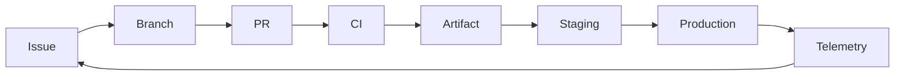

# AZ-400 Lab Workbook

This workbook supplies guided labs and practice exercises for the modules in [AZ-400-course.md](AZ-400-course.md). The examples use a small Node.js service, Git, GitHub, GitHub Actions, Azure DevOps, and Azure. You can substitute an equivalent application stack, but keep the learning objectives and verification steps.

## How to Use This Workbook

- Complete Lab 0 first; later labs reuse its repository and service.
- Each lab has a goal, preparation, procedure, verification, and extension exercise. Record screenshots or run URLs only when they contain no secrets or customer data.
- Azure labs are optional and can incur charges. Use a dedicated subscription, a disposable resource group, and your organization's approval. Run the cleanup commands at the end of each Azure lab.
- Commands are for Bash. Replace every `<placeholder>`. Commands that publish, rewrite history, grant access, or delete resources require extra care. Never commit real credentials.
- GitHub and Azure DevOps menu names, plan entitlements, agent images, action/task versions, and service capabilities change. Verify current availability before relying on them in a production design.

## Lab 0: Build the Shared Sample Service

### Goal

Create a small, dependency-free HTTP service and test suite to reuse in later Git, pipeline, container, and monitoring labs.

### Preparation

Install a supported Node.js LTS release, npm, Git, and (for later hosted labs) `gh` and `az`. Create a GitHub repository and an Azure DevOps project if available.

```bash
node --version
npm --version
git --version
gh --version
az version
gh auth status
az account show --output table
```

### Procedure

```bash
mkdir az400-lab
cd az400-lab
npm init -y
npm pkg set scripts.start="node server.js"
npm pkg set scripts.test="node --test"
```

Create `server.js`:

```javascript
const http = require('node:http');

function responseFor(path) {
  if (path === '/health') {
    return { status: 200, body: JSON.stringify({ status: 'ok' }) };
  }
  if (path === '/fail') {
    return { status: 503, body: JSON.stringify({ status: 'unavailable' }) };
  }
  return { status: 200, body: 'AZ-400 lab service' };
}

function handler(request, response) {
  const result = responseFor(new URL(request.url, 'http://localhost').pathname);
  response.writeHead(result.status, { 'content-type': 'application/json; charset=utf-8' });
  response.end(result.body);
}

if (require.main === module) {
  const port = Number(process.env.PORT || 3000);
  http.createServer(handler).listen(port, '0.0.0.0', () => {
    console.log(`Listening on ${port}`);
  });
}

module.exports = { handler, responseFor };
```

Create `server.test.js`:

```javascript
const test = require('node:test');
const assert = require('node:assert/strict');
const { responseFor } = require('./server');

test('health endpoint is healthy', () => {
  assert.deepEqual(responseFor('/health'), {
    status: 200,
    body: JSON.stringify({ status: 'ok' })
  });
});

test('failure endpoint returns service unavailable', () => {
  assert.equal(responseFor('/fail').status, 503);
});

test('unknown route returns the service greeting', () => {
  assert.match(responseFor('/').body, /AZ-400 lab service/);
});
```

Run tests and start the service in a terminal:

```bash
npm test
npm start
```

From a second terminal, verify the health and failure responses:

```bash
curl --include http://localhost:3000/health
curl --include http://localhost:3000/fail
```

Initialize Git and commit the baseline:

```bash
git init -b main
git add package.json package-lock.json server.js server.test.js
```

If `package-lock.json` does not exist, generate one with `npm install --package-lock-only` before adding it. Then commit:

```bash
git commit -m "Create AZ-400 lab service"
```

### Verify

- `npm test` reports three passing tests.
- `/health` returns HTTP 200 and JSON status `ok`.
- `/fail` returns HTTP 503.
- Git status is clean after the commit.

### Exercises

1. Add `/version` and test it. Read the version from `package.json` rather than hard-coding it.
2. Add a test that fails, observe the exit code, then repair the test.
3. Identify which files are source, tests, generated output, package metadata, and secrets. Add appropriate generated files to `.gitignore`.

## Lab 1: Work Tracking, Flow, Traceability, and Metrics

### Goal

Trace one requirement through an issue/work item, branch, commit, PR, checks, and release. Define metrics that help the team improve flow.

### Procedure: GitHub path

Create an issue in the lab repository and note its number. If creating a new repository:

```bash
gh repo create <owner>/az400-lab --private --source . --remote origin --push
gh issue create --repo <owner>/az400-lab --title "Add version endpoint" --body "Expose the app version and test it."
```

Use the issue number returned by the second command:

```bash
git switch -c feature/version-endpoint
```

Implement the endpoint and test from Lab 0, then link the change in the commit/PR. For GitHub, use a closing keyword with the actual issue number:

```bash
git add server.js server.test.js
git commit -m "Add version endpoint"
git push -u origin feature/version-endpoint
gh pr create --repo <owner>/az400-lab --title "Add version endpoint" --body "Closes #<issue-number>"
```

Confirm the issue, PR, and commit link to one another. If you use Azure Boards, create a work item and configure the supported GitHub integration. The Azure DevOps CLI extension can create work items and run WIQL queries:

```bash
az extension add --name azure-devops
az devops configure --defaults organization=https://dev.azure.com/<organization> project=<project>
az boards work-item create --title "Add version endpoint" --type "User Story"
az boards query --wiql "SELECT [System.Id], [System.Title], [System.State] FROM WorkItems WHERE [System.WorkItemType] = 'Bug' AND [System.State] <> 'Closed' ORDER BY [System.ChangedDate] DESC"
```

Authenticate with the signed-in Azure identity or the supported secure login flow. Do not paste a PAT into a command, shell history, or course notes.

### Procedure: flow metrics

Create a simple flow board in GitHub Projects or Azure Boards with columns such as Ready, Active, Review, Done. Define a start/end event for cycle time and lead time. Record a baseline for a small set of sample items; do not use invented precision or compare teams without context.

Write a metric card for each measure:

| Measure | Example definition | Source | Question it should answer |
|---|---|---|---|
| Lead time | Production timestamp minus work-start timestamp | Work tracker and deployment record | How long does a change take to reach users? |
| Cycle time | Done timestamp minus Active timestamp | Work tracker | Where does active work wait? |
| Deployment frequency | Successful production deployments per period | Pipeline/deployment records | How often can value be delivered? |
| Change failure rate | Deployments requiring rollback/hotfix divided by deployments | Release and incident records | Are releases creating operational harm? |
| Time to restore | Incident detection to service restoration | Incident system/telemetry | How quickly do we recover? |
| Build health | Failures, duration, queue time, flaky tests | Pipeline runs | Where is delivery feedback slow or unreliable? |

Use a dashboard or spreadsheet to display these values, their date window, source, and owner. In Azure Boards, create a query for active bugs or aging work and add it to a dashboard. In GitHub Projects, use built-in views/charts where available. In Azure DevOps, use Analytics/Widgets when available for the organization and project.

### Verify

- A reviewer can navigate from the issue/work item to the PR and commit.
- The merged change has an auditable check result and release reference.
- Every metric has a precise definition, data source, owner, and intended action.

### Exercises

1. Define one query or chart for planning, development, testing, security, delivery, and operations.
2. Explain why commit count, lines of code, or individual utilization is a poor stand-alone productivity measure.
3. Identify one source of bias or missing data in each metric and propose how to disclose it.

## Lab 2: Documentation, Collaboration, and Integrations

### Goal

Version project documentation, generate release notes, and design a secure webhook/team integration.

### Procedure

Create `docs/architecture.md` with this Mermaid diagram:



Add a runbook containing health URL, owner, alert destination, rollback trigger, and recovery steps. Add an OpenAPI contract if the service exposes an API. Keep operational steps versioned with the application.

Create a PR template in `.github/pull_request_template.md`:

```markdown
## Work item

## Change and risk

## Tests and security checks

## Documentation impact
```

Inspect Git history and generate release notes for a test release:

```bash
git log --oneline --decorate -10
gh release create v0.1.0 --repo <owner>/az400-lab --generate-notes --title "v0.1.0"
```

If no release exists yet, create a GitHub release from a merged commit. Review the generated notes before publishing; generated history is a draft, not automatically accurate user documentation.

Configure a non-production webhook using a test receiver or an approved integration. Subscribe only to required events. Verify HTTPS delivery, request signature, retry behavior, duplicate-event idempotency, and that secrets are not in payloads/logs. Configure Azure Boards/GitHub and GitHub/Azure DevOps-to-Teams integration through the products' integration settings, selecting a test project/channel and only the needed notifications.

### Verify

- Markdown renders, Mermaid diagram is readable, and links resolve.
- Release notes identify user-visible changes and omit irrelevant commits.
- Webhook receiver rejects invalid signatures and safely handles a repeated event.
- Teams notifications reach only the intended test channel without exposing secret values.

### Exercises

1. Decide which content belongs in repo Markdown, wiki, release notes, and API docs.
2. Write a webhook failure runbook covering timeouts, retries, duplicate delivery, and credential rotation.
3. Propose a process to detect stale runbook and API documentation.

## Lab 3: Branching, Pull Requests, and Repository Permissions

### Goal

Apply a branch strategy and enforce review/check requirements on the default branch.

### Procedure

Create two short-lived feature branches, make separate changes, and open PRs. Compare small, frequently merged changes with one long-lived branch. Decide whether your sample team needs trunk-based, feature-branch, or release-branch development.

On GitHub, configure a repository ruleset or branch protection rule for `main`:

1. Require a PR before merging.
2. Require at least one approval and resolve review conversations.
3. Require build/test status checks after the workflow exists.
4. Restrict force pushes/deletions and narrowly limit bypass.
5. Choose merge commit, squash, or rebase and document how the choice affects history.

On Azure Repos, configure corresponding branch policies for reviewers, build validation, linked work items, and resolved comments. Assign permissions to a team/security group rather than many individuals. Test the rule with a non-admin user. Protect release tags if the organization depends on signed/versioned release tags.

### Verify

- A direct push to the protected branch is denied for a contributor.
- A PR with a failing required check cannot merge.
- A PR with all requirements met can merge using the selected strategy.
- Only documented administrators can bypass policy, and bypass is auditable.

### Exercises

1. Design a branch and release model for a daily SaaS service and for a supported quarterly on-prem release.
2. Add a hotfix scenario and specify how it merges back to main and supported release branches.
3. Document how feature flags allow unfinished code to merge without exposing unfinished behavior.

## Lab 4: Large Repositories, Git LFS, Scalar, and Recovery

### Goal

Select an appropriate large-file/repository strategy and practice safe recovery in a disposable clone.

### Procedure

Install Git LFS from its official distribution and track a generated dummy asset (do not use sensitive or copyrighted files):

```bash
git lfs install
git lfs track "*.bin"
git add .gitattributes
```

Create a small dummy file, commit it, and inspect the pointer and tracked file list:

```bash
dd if=/dev/zero of=sample.bin bs=1024 count=64
git add sample.bin
git commit -m "Add LFS test asset"
git lfs ls-files
git show HEAD:sample.bin
```

If Scalar is available in the installed Git distribution, compare a normal clone and a Scalar clone of a large test repository:

```bash
scalar clone <repository-url>
scalar list
```

Use a disposable repository to practice undo/recovery:

```bash
git log --oneline
git revert <commit-sha>
git reflog
git switch -c recovery/test <reflog-or-commit-ref>
git fsck --lost-found
```

For a history-removal drill, create a fake marker string (never a real credential), commit it, and install `git-filter-repo` using its official instructions. From a fresh disposable clone, remove the file:

```bash
git filter-repo --path test-secret.txt --invert-paths
git log --all -- test-secret.txt
```

History rewriting changes commit IDs. Do not force-push a real shared repository without security/owner approval and a coordinated clone/branch/fork plan. In a real credential incident, revoke or rotate first; rewriting history does not revoke a credential.

For `git-fat`, identify the maintained implementation and remote storage required by your organization. Its command syntax/setup differs between implementations, so follow its own docs rather than copying commands from another implementation.

### Verify

- `.gitattributes` tracks the intended pattern and LFS can retrieve the dummy object.
- `git revert` creates a new undo commit rather than rewriting shared history.
- `git reflog` can locate a previous local reference in the disposable repo.
- The history-removal drill finds no matching file in rewritten refs.

### Exercises

Compare LFS, git-fat, Scalar, submodules, subtrees, packages, and separate repositories for a monorepo with binaries and shared libraries. Include collaboration, access, clone time, quotas, ownership, and recovery.

## Lab 5: Package Feeds and Versioning

### Goal

Package the sample app, choose SemVer or CalVer intentionally, and promote an immutable version through a feed.

### Procedure: local package

Add package metadata and inspect a package without publishing:

```bash
npm pkg set name="@<scope>/az400-lab"
npm pkg set version="0.1.0"
npm pack --dry-run
npm pack
```

Explain why `0.1.0` is a pre-1.0 version and define what would constitute a breaking change, new feature, and compatible fix for your package. For a date version, document the date format and whether it also conveys compatibility.

### Procedure: feed promotion

Create a private test feed in GitHub Packages or Azure Artifacts. Follow the feed's official npm registry configuration and use the provider credential manager or pipeline service connection. Do not commit `.npmrc` files containing tokens. Publish only the sample package, then consume the exact version from a clean test project. If the provider uses views/stages, publish first to a development view, validate it, then promote to a release view.

Record the package version, source commit, pipeline run, registry URL, digest/checksum if available, and promotion approval. Attempt to publish the same immutable version again and record the provider's behavior.

### Verify

- The package can be installed from the intended private feed using authorized identity.
- A clean consumer can resolve the exact version without relying on a developer's local cache.
- Package and pipeline artifact versions are immutable and tied to a source revision.
- Upstream sources and package views have a clear trust/promotion policy.

### Exercises

1. Choose SemVer or CalVer for an SDK, a dated internal build, and a container image; justify each choice.
2. Define feed permissions for publishers, consumers, and release approvers.
3. Set retention for development packages, release packages, pipeline artifacts, and dependency caches.

## Lab 6: Tests, Coverage, and Quality Gates

### Goal

Run a test matrix in CI, publish test results/coverage, and prove a failed check blocks deployment.

### Procedure

Run tests locally, then add a coverage tool as a development dependency:

```bash
npm install --save-dev c8
npm pkg set scripts.coverage="c8 --reporter=text --reporter=cobertura node --test"
npm run coverage
```

Inspect the report and identify untested branches. Add a test for a meaningful behavior, not merely a line-count target. Add test and coverage steps to the pipeline from Lab 7. Upload reports as pipeline artifacts and publish the supported test-result format. For Node's test runner, confirm your chosen publisher can ingest its output; if not, configure an appropriate JUnit reporter.

Add a temporary deliberately failing assertion and run the pipeline. Confirm the job fails and a downstream deployment stage does not run. Remove the failing assertion. Define PR, nightly, and pre-release suites: fast unit tests on every PR, integration tests where dependencies are available, and load tests in a controlled environment.

### Verify

- A failed unit test fails CI and blocks promotion.
- Test/coverage output is retained and associated with the source commit.
- The team can tell a flaky test from a deterministic product regression.
- Coverage thresholds reflect risk and do not replace review or behavioral tests.

### Exercises

Create a test strategy matrix with test type, environment, trigger, execution time, owner, and failure policy. Propose how to isolate test data and parallelize without race conditions. Define a quarantine/repair policy for flaky tests.

## Lab 7: YAML Pipelines, Triggers, Agents, and Reuse

### Goal

Build and test the service on pull requests, publish an artifact, and compare GitHub Actions with Azure Pipelines.

### GitHub Actions procedure

Create `.github/workflows/ci.yml`:

```yaml
name: ci
on:
  pull_request:
    branches: [main]
  push:
    branches: [main]
permissions:
  contents: read
jobs:
  test:
    runs-on: ubuntu-latest
    steps:
      - uses: actions/checkout@v4
      - uses: actions/setup-node@v4
        with:
          node-version: 22
          cache: npm
      - run: npm ci
      - run: npm test
      - run: npm run coverage
      - uses: actions/upload-artifact@v4
        if: always()
        with:
          name: coverage
          path: coverage/
```

Ensure `package-lock.json` is committed so `npm ci` succeeds. For production, review and pin third-party actions to trusted full-length commit SHAs; keep only required token permissions. Do not run secrets in workflows triggered by untrusted code.

### Azure Pipelines procedure

Create `azure-pipelines.yml`:

```yaml
trigger:
  branches:
    include:
    - main
pr:
  branches:
    include:
    - main
pool:
  vmImage: ubuntu-latest
steps:
- task: NodeTool@0
  inputs:
    versionSpec: '22.x'
- script: npm ci
  displayName: Install dependencies
- script: npm test
  displayName: Run tests
- script: npm run coverage
  displayName: Measure coverage
- publish: coverage
  artifact: coverage
  condition: always()
```

Connect Azure Pipelines to the GitHub repository with the minimum repository permissions, then verify the PR status is reported. Use YAML templates for shared steps and variable templates/groups for non-secret configuration; store secrets in a protected secret store and authorize only intended pipelines. Create a protected environment with approval/checks before any deployment stage.

### Agent/runner experiment

Document the hosted agent's operating system, tools, concurrency, network reach, and cost/licensing constraints. Design a self-hosted alternative for a private dependency: isolate it, patch it, restrict network egress, avoid persistent credentials, and do not run untrusted PR code on a privileged runner. If using a self-hosted agent, run a harmless test job only.

### Verify

- PR and main push triggers run the expected jobs.
- A failing test results in a failed pipeline status.
- Artifact/report is available even when the test job fails.
- A PR cannot deploy to a protected production environment.

### Exercises

Add a path filter, a second independent validation job, and a dependent packaging job. Explain when parallel execution reduces elapsed time and when it increases cost or creates contention. Create a reusable template/workflow and document its versioning strategy. Compare hybrid GitHub + Azure Pipelines architecture with using one platform end to end.

## Lab 8: Deployment Strategies, Feature Flags, and Hotfixes

### Goal

Design a safe release plan and practice a feature flag/rollout decision using the sample service.

### Procedure

Create a deployment decision record covering: target platform, artifact identity, deployment order, health probes, traffic exposure, rollback/roll-forward, database compatibility, approval, and owner. Compare blue-green, canary, ring, rolling, deployment slot swap, feature flags, and A/B testing against the service's capacity and risk.

For a local feature flag exercise, add a flag controlled by an environment variable. Verify the default is off and the feature can be enabled without rebuilding. Then write how Azure App Configuration Feature Manager would provide centralized targeting/filters and how the application SDK would read the flag. If you have an Azure lab subscription and service access, create a non-production feature flag in App Configuration, connect a sample app with the supported SDK, and verify a test cohort before broad enablement.

If using Azure App Service, create a disposable test app and slot only after reviewing the pricing tier and cleanup cost. Validate the non-production slot, configure health checks/settings, and swap using the portal or current Azure CLI command documentation. Do not run production traffic through the exercise. Treat database tasks separately and use backward-compatible expand/migrate/contract changes.

Define a hotfix route: incident/priority criteria, named approver, minimum tests, protected emergency bypass if applicable, artifact provenance, deployment verification, merge-back to main/release branches, and retrospective. Emergency process must remain auditable.

### Verify

- The exact same immutable artifact is promoted between environments.
- A failed health signal halts progressive exposure and triggers the documented recovery action.
- The feature flag can be disabled independently of deployment and has an owner/expiry.
- Database changes work with both currently deployed and next application versions.

### Exercises

Select one rollout strategy for a service with one instance, then for a multi-region service. Explain capacity requirements, monitoring thresholds, dependency ordering, and how load balancing, rolling deployment, or slot swap minimizes downtime. Design an A/B test with a measurable outcome and safety guardrail.

## Lab 9: IaC, Desired State, and Developer Environments

### Goal

Validate and deploy a small Azure resource from Bicep, and design a governed self-service environment workflow.

### Preparation

This lab requires an Azure subscription. Create a unique disposable resource group and check applicable policies/costs. If you cannot deploy, perform the local Bicep build and discuss the expected plan/what-if output.

```bash
az login
az account set --subscription <subscription-id>
az group create --name <unique-resource-group> --location <region>
```

Create `main.bicep`:

```bicep
param storageAccountName string
param location string = resourceGroup().location

resource storage 'Microsoft.Storage/storageAccounts@2023-05-01' = {
  name: storageAccountName
  location: location
  sku: {
    name: 'Standard_LRS'
  }
  kind: 'StorageV2'
  properties: {
    supportsHttpsTrafficOnly: true
    minimumTlsVersion: 'TLS1_2'
  }
}
```

Use a globally unique lowercase storage account name of 3-24 alphanumeric characters. Build, validate, inspect, then deploy:

```bash
az bicep build --file main.bicep
az deployment group validate --resource-group <unique-resource-group> --template-file main.bicep --parameters storageAccountName=<unique-name>
az deployment group what-if --resource-group <unique-resource-group> --template-file main.bicep --parameters storageAccountName=<unique-name>
az deployment group create --resource-group <unique-resource-group> --template-file main.bicep --parameters storageAccountName=<unique-name>
az storage account show --name <unique-name> --resource-group <unique-resource-group> --output table
```

Commit the Bicep source. Add a CI check that runs build/validate on PR and a protected deployment stage that requires what-if review. Do not store credentials or state in the repository.

### Desired state and environment design exercise

For a VM/application configuration case, compare Azure Automation State Configuration, Azure Machine Configuration, ARM/Bicep, and a configuration-management tool such as Ansible or PowerShell DSC. Separate provisioning cloud resources from enforcing software/OS configuration. Specify drift detection, remediation mode, agent/connectivity, policy, and audit.

Design Azure Deployment Environments for a team: catalog templates, project/environment types, role permissions, quotas, policy, supported regions, lifetime/expiry, cost ownership, cleanup, and network boundaries. Identify how a developer requests and self-deploys a temporary environment and how the organization prevents orphaned resources.

### Verify and clean up

Confirm `what-if` matched the intended change and the storage account enforces HTTPS/TLS. Delete the resource group when finished:

```bash
az group delete --name <unique-resource-group> --yes --no-wait
```

### Exercises

1. Add a parameterized dev/test configuration and explain which values should not vary.
2. Design PR validation, approval, deployment, drift detection, and rollback for an IaC change.
3. Compare Bicep/ARM and desired-state configuration for a resource versus software inside a machine.

## Lab 10: Pipeline Health, Optimization, Retention, and Migration

### Goal

Measure pipeline health, optimize one bottleneck, define retention, and plan a classic-to-YAML migration.

### Procedure

Capture baseline from at least five runs: queue time, duration, success/failure, flaky-test reruns, and artifact size. Record the agent image/tool versions. Inspect a failed run's diagnostic logs and identify the first causal error rather than the last cascading failure.

Apply one optimization at a time: dependency caching, path-based build selection, parallel independent jobs, removing duplicate work, right-sizing an agent, or isolating flaky tests. Re-run at least five times and compare median/p95 duration and failure rate. Do not cache secrets or share writable cache state across untrusted jobs.

Write a retention table for logs, test results, pipeline artifacts, packages, dependency caches, and release provenance. Identify legal/audit requirements, access, expiration, and restore needs. For a classic Azure Pipeline, inventory triggers, variables, service connections, tasks, demands, approvals, and retention. Recreate in YAML in parallel, compare outputs and permissions, then schedule cutover/rollback.

### Verify

- Optimization has measured effect and does not reduce test/security coverage.
- Concurrency is within agent capacity and expected cost.
- Artifacts needed for release support/audit survive normal cleanup.
- Classic and YAML pipelines produce equivalent outputs before the classic pipeline is retired.

### Exercises

Given a slow queue and long build, identify whether the bottleneck is concurrency, agent setup, dependency download, tests, or serialization. Propose a ranked fix list with risk and measurement. Design an artifact retention policy for a regulated release and a short-lived PR build.

## Lab 11: Identity, Permissions, Service Connections, and Teams

### Goal

Choose the right workload identity and prove least privilege for one pipeline deployment.

### Procedure

Draw the identity path from pipeline/runner to Azure. Compare a system-assigned managed identity, user-assigned managed identity, service principal with secret, and workload identity federation/OIDC. For each, note lifetime, where it runs, credential handling, role scope, rotation, and revocation.

For GitHub Actions, configure an Azure federated credential for the repository/environment subject using current Microsoft documentation. Assign only the resource role required. In workflow YAML, use minimal token permissions and `id-token: write` only for the job that needs an OIDC token. The permission to request a token is not itself Azure authorization.

For Azure Pipelines, create a test service connection using the supported workload identity federation option, scope its resource access, and authorize only the intended pipeline. Avoid granting all pipelines access. Test both the intended resource and an unrelated resource; the second request should fail.

Configure a test GitHub team/repository role and Azure DevOps project/security group. Review stakeholder access and GitHub outside-collaborator access for the specific tasks required. Connect a test Teams channel to GitHub or Azure DevOps and confirm notifications do not contain secrets or unnecessary personal data.

### Verify

- Intended operation succeeds with the pipeline identity.
- Unrelated resource access is denied.
- GitHub token permissions, service connection scope, and user/team roles are minimal.
- PATs, if present for a specific legacy integration, have owner, expiry, minimal scopes, storage, and rotation plan.

### Exercises

1. Select system-assigned vs user-assigned identity for two Azure services and justify lifecycle trade-offs.
2. Explain when a GitHub App is preferable to a PAT and when `GITHUB_TOKEN` is sufficient.
3. Create an access matrix for developers, release managers, auditors, external contributors, and administrators.

## Lab 12: Key Vault, Secrets, Certificates, and Secure Files

### Goal

Retrieve a harmless lab secret without logging its value and document secure-file controls.

### Procedure: Azure Key Vault

Use a disposable resource group. Create a vault using the current organization's naming and access model:

```bash
az keyvault create --name <globally-unique-vault-name> --resource-group <resource-group> --location <region>
az keyvault secret set --vault-name <globally-unique-vault-name> --name lab-message --value "non-sensitive-lab-value"
az keyvault secret show --vault-name <globally-unique-vault-name> --name lab-message --query id --output tsv
```

Grant a test workload identity only the required secret-read permission using the vault's current RBAC/access configuration. Retrieve the secret in a test pipeline through the approved Key Vault task/SDK and use it in a harmless operation without printing it. Confirm logs redact the value. Remove the secret and revoke test access afterward.

### Procedure: secure files and leakage prevention

In Azure Pipelines, upload a harmless dummy file as a secure file, authorize only the test pipeline, and download it only in the one deployment job that needs it. Confirm the file is not included in a published artifact or retained workspace. A secure file does not replace access control or cleanup.

Run a local secret scan against a fake test marker only. Review `.gitignore`, pipeline logs, artifacts, command-line arguments, container layers, and test output for leakage paths. Do not put real credentials into this exercise.

### Verify

- Pipeline identity can read only the intended secret.
- Secret value never appears in logs/artifacts.
- Secure file authorization is pipeline-scoped and workspace cleanup is understood.
- Rotation, expiry, ownership, audit, and exposure response are documented.

### Exercises

Create a secret inventory for build, signing, deploy, and runtime. Replace one stored CI credential with OIDC or managed identity. Write a response checklist for a secret accidentally committed to a public repository.

## Lab 13: Dependency, Code, Secret, License, Container, and IaC Scanning

### Goal

Create a layered security gate and route sample findings to owners.

### Procedure

On a disposable repository, enable the available dependency graph and Dependabot alerts/updates. Review one intentionally generated or documented sample alert; do not introduce a real exploitable dependency into a production service. Configure CodeQL using the supported GitHub workflow generator or current action versions. For JavaScript, a minimal job includes checkout, CodeQL init, build where required, and analyze. In production, pin reviewed actions by commit SHA and configure minimal token permissions.

If a CodeQL workflow must run inside a container, use a job container supported by current CodeQL requirements and validate the image, CLI/runtime, language build mode, and runner compatibility. For compiled languages, ensure the build occurs between initialization and analysis where required. Do not give an untrusted PR privileged credentials or access to a persistent self-hosted runner.

Build and scan the sample image (Dockerfile below):

```dockerfile
FROM node:22-alpine
WORKDIR /app
COPY package*.json ./
RUN npm ci --omit=dev
COPY server.js ./
EXPOSE 3000
CMD ["npm", "start"]
```

Build and scan with an approved scanner such as Trivy if installed:

```bash
docker build --tag az400-lab:dev .
trivy image --severity HIGH,CRITICAL --exit-code 1 az400-lab:dev
```

Define policies for open-source licenses, dependency age, severity thresholds, IaC findings, and exception expiry. If licensed, connect a test repository to Microsoft Defender for Cloud DevOps Security and GitHub Advanced Security for GitHub or Azure DevOps. Verify repository authorization and alert flow. Assign a sample finding to an owner and record remediation/waiver evidence.

### Verify

- Dependency, CodeQL, secret, license, container, and IaC controls are mapped to stages and owners.
- A blocking threshold fails the pipeline; a permitted exception has approver, reason, expiry, and audit trail.
- Findings are visible to the responsible team and remediation SLA.
- Container image is promoted by immutable digest rather than mutable tag alone.

### Exercises

Draw a threat path for an untrusted PR targeting a self-hosted runner. List isolation controls. Design scanning gates for a library, a container service, and an IaC repository. Explain how Dependabot alerts differ from automatic update PRs.

## Lab 14: Azure Monitor, Application Insights, and Pipeline Monitoring

### Goal

Instrument a non-production application and delivery workflow; create actionable alerts.

### Procedure

Create a disposable Log Analytics workspace and Application Insights resource through the current Azure portal or CLI. Follow current language SDK guidance to add telemetry to the sample application or a supported sample app. Capture requests, failures, dependencies, exceptions, and traces. Scrub sensitive fields and choose retention/sampling based on cost and diagnostic needs.

If resources are available, enable relevant VM Insights, Container Insights, Azure Monitor for Storage, and Azure Monitor for Networks. Collect only telemetry required for operational questions. Record the CPU, memory, disk, network, platform, and application signals you expect to use.

Configure a test alert for a sustained availability/error-rate condition and route it to a test action group/channel. Cause a controlled `/fail` request or a safe test failure and verify the alert's signal, threshold, evaluation window, route, and runbook. Monitor GitHub Actions/Azure Pipelines outcomes and configure charts/alerts for failed runs, duration, queue time, or important workflow events. Avoid alerting on every transient event.

Discovery commands (exact create operations depend on the chosen resource and installed CLI extensions):

```bash
az monitor --help
az monitor log-analytics workspace list --resource-group <resource-group> --output table
az monitor app-insights component list --resource-group <resource-group> --output table
```

### Verify

- Test telemetry arrives with correct service/environment dimensions.
- A test alert reaches the intended receiver and provides an actionable link/runbook.
- Sensitive data is not collected; retention and sampling are documented.
- GitHub/Azure DevOps pipeline metrics have an owner and response action.

### Exercises

Create an instrumentation plan with metric, log, trace, source, retention, sampling, alert threshold, owner, and expected response. Explain how service usage and application performance measurements affect capacity and product decisions.

## Lab 15: KQL and Distributed Trace Investigation

### Goal

Use logs, metrics, and traces together to investigate a simulated service regression.

### Procedure

In the Application Insights/Log Analytics query editor, generate a successful request and a controlled failing request. Table names vary by workspace and ingestion mode; use the schema/autocomplete to select classic `requests`/`dependencies`/`exceptions` or workspace-based `AppRequests`/`AppDependencies`/`AppExceptions` tables.

Example classic-schema request summary:

```kusto
requests
| where timestamp > ago(24h)
| summarize requestCount=count(), failures=countif(success == false) by bin(timestamp, 1h)
| order by timestamp desc
```

Find exceptions:

```kusto
exceptions
| where timestamp > ago(24h)
| summarize count() by type, problemId
| top 10 by count_
```

Find failed dependencies and trace correlation:

```kusto
dependencies
| where timestamp > ago(1h) and success == false
| project timestamp, name, target, resultCode, duration, operation_Id
| order by timestamp desc
```

Use an `operation_Id` from a failed request to inspect related request, dependency, exception, and trace records. Compare the timestamps with CPU, memory, disk, and network charts and the deployment timeline. Build an incident timeline; identify user impact, likely cause, mitigation, and follow-up work item.

### Verify

- Queries are time-bounded and use the actual workspace schema.
- Trace correlation identifies the failing operation/dependency rather than relying on isolated log lines.
- Infrastructure and application signals are compared over the same time interval.
- Incident findings link to the deployment, source commit, and follow-up issue.

### Exercises

1. Write a query for slow requests above a chosen duration and group by operation/name.
2. Write a query that counts failures by result code over time.
3. Explain how high-cardinality dimensions or excessive retention can increase telemetry cost.
4. Propose a post-incident change to code, pipeline, alert, or runbook that prevents recurrence or shortens detection/recovery.

## Lab 16: End-to-End Capstone

### Scenario

The team must deliver a version endpoint to a monitored service with a secure release and auditable traceability.

### Required implementation

1. Create a work item/issue and link it to a short-lived branch, PR, commit, check run, artifact, and deployment.
2. Enforce protected-branch review, required tests, and security checks.
3. Maintain a Mermaid process diagram, runbook, API notes, and reviewed release notes.
4. Build and test on PR; publish test results, coverage, and an immutable artifact.
5. Include package/dependency, code, secret, license, container, or IaC scanning as applicable.
6. Promote the same artifact through a staged deployment with approval/health checks and documented rollback/hotfix flow.
7. Use a managed identity or workload identity federation for Azure; scope access minimally. Store unavoidable runtime secrets in Key Vault.
8. Provision a disposable environment from IaC and validate what-if before apply.
9. Emit application/pipeline telemetry, configure an alert, and investigate one simulated failure with KQL/traces.
10. Present a dashboard and metric definitions for flow, delivery, security, and operations.

### Review rubric

Score each from 0 to 2: 0 = missing/unsafe; 1 = works with gaps; 2 = works and is documented.

| Category | Evidence |
|---|---|
| Traceability | Work item to source, pipeline, artifact, deployment, and incident links |
| Source control | Branch model, protections, review, and recovery policy |
| CI and tests | Reproducible build, useful tests, results, coverage, and quality gate |
| Release | Immutable promotion, environment checks, rollout strategy, rollback/hotfix |
| IaC | Versioned source, validation/what-if, approvals, drift/cleanup plan |
| Security | Least privilege, secret handling, scanning, finding ownership |
| Monitoring | Actionable telemetry/alerts, trace correlation, KQL investigation |
| Operations | Retention, reliability/cost review, runbook, and lessons learned |

Target at least 12/16, with no zero in security, release, or monitoring. Fix gaps and repeat the capstone without copying the original runbook.

## Final Cleanup Checklist

- [ ] Stop local services and remove disposable working directories when no longer needed.
- [ ] Delete temporary Azure resource groups and verify deletion completed.
- [ ] Revoke test service connections/role assignments and remove test identities.
- [ ] Delete lab secrets, certificates, secure files, test feeds/packages, and temporary GitHub releases where appropriate.
- [ ] Remove fake secret markers and test vulnerabilities from active branches.
- [ ] Confirm no real credential appears in Git history, logs, artifacts, terminal history, or screenshots; rotate immediately if exposed.
- [ ] Retain only course evidence allowed by organizational policy.
