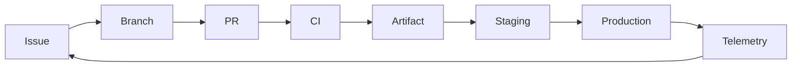

# Module 02: Documentation and Collaboration

## Lesson Notes

Use Markdown wikis/repositories for project docs and Mermaid for process diagrams. Generate release-note drafts from Git history, labels, or PRs, then review them. Keep API docs tied to an API contract. Webhooks need HTTPS, signature validation, least privilege, retries/idempotency, and redaction. Integrate Azure Boards with GitHub and GitHub/Azure DevOps with Microsoft Teams while routing useful notifications only.

## Lab Notes

Add a Mermaid flow and runbook with owner, health check, alert destination, rollback trigger, and recovery steps:



Inspect history and draft release notes:

```bash
git log --oneline --decorate -10
gh release create v0.1.0 --generate-notes --title "v0.1.0"
```

Configure a test webhook or approved integration. Verify valid/invalid signatures, duplicate deliveries, retries, and secret redaction. Connect a test Boards project and Teams channel using current integration settings.

## Exercises

1. Decide what belongs in a wiki, repo docs, release notes, and API docs.
2. Write a webhook outage/retry runbook.
3. Define ownership and review cadence for docs; explain how Git history can automate release notes.

## Verification

- Mermaid and Markdown render and links resolve.
- Release notes are reviewed before publishing.
- Webhook rejects invalid signatures and handles duplicates safely.
- Teams notifications reach only the intended test channel.
